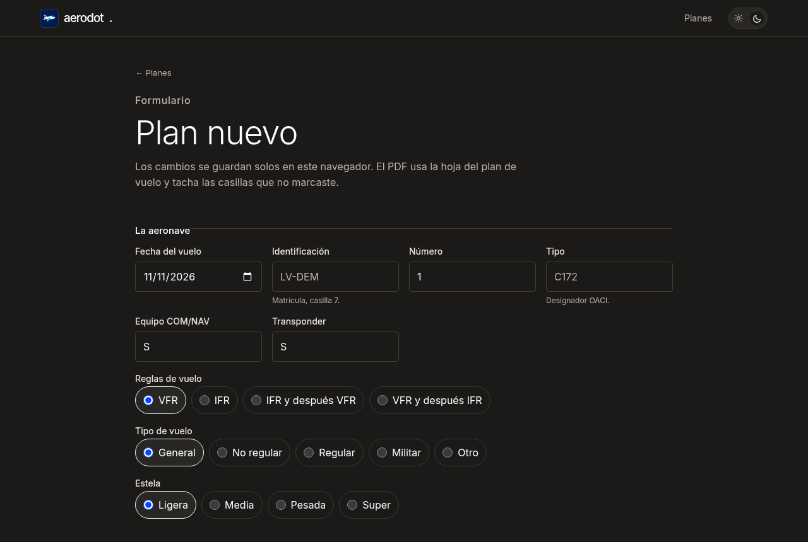

<div align="center">


# Aerodot Plan

Armá un plan de vuelo, guardalo en el navegador y bajalo en PDF sobre la hoja de EANA.

[](https://aerodot-plan.vercel.app)
[](https://astro.build)
[](https://pdf-lib.js.org)
[](LICENSE)


</div>

<p align="center">
  
</p>

## Qué hace

- **Lista de planes** guardados en este navegador, con opción de eliminar.
- **Editor** con los campos del formulario: aeronave, reglas y tipo de vuelo, ruta, autonomía, equipo de emergencia, etc. Los cambios se guardan solos.
- **Firma del piloto** dibujada en pantalla y guardada con el plan.
- **PDF** armado en el navegador con [pdf-lib](https://pdf-lib.js.org/) sobre `public/forms/plan-de-vuelo-eana.pdf`. Tacha las casillas que no marcaste y pone la firma.
- **Sin cuentas ni servidor:** todo queda en el `localStorage` del navegador.
- Tema claro y oscuro.

Es un proyecto aparte de [Aerodot](https://aerodot.vercel.app) y no comparte código con la biblioteca. Aerodot no presenta el plan ante nadie: revisá los datos antes de llevarlo.

## Correrlo en local

Hace falta Node 22.12 o más nuevo (lo pide Astro 6).

```bash
npm install
npm run dev       # http://localhost:4321
npm run build     # sitio estático en dist/
```

## Estructura

```
src/
  pages/index.astro             lista de planes
  pages/editar.astro            editor
  scripts/flight-plan-list.js   lista y borrado
  scripts/flight-plan-editor.js formulario, firma y PDF
  data/flight-plan.js           campos del plan y guardado
public/forms/                   hoja del plan de vuelo (PDF base)
```

## Stack

Astro · JavaScript · pdf-lib · CSS propio.

## Licencia

Código: [MIT](LICENSE). La fuente Inter tiene su propia licencia en `public/fonts/LICENSE.txt`.
